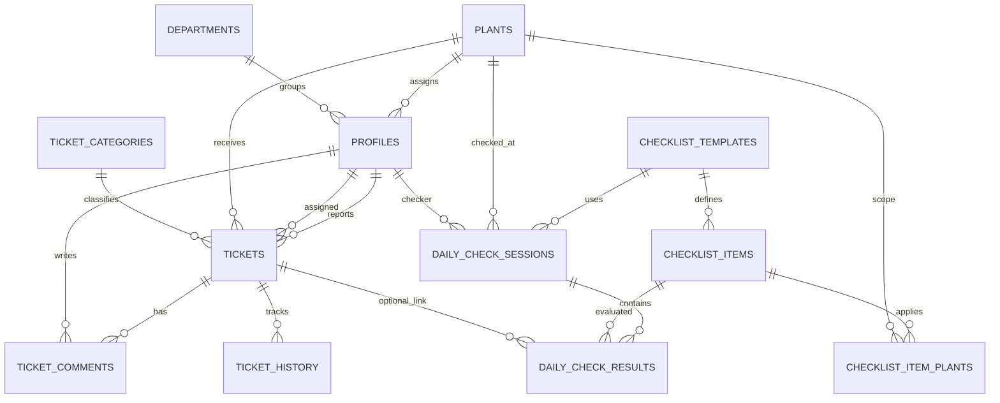

# ERD — DKI IT Service Desk

## Entitas
- `plants`, `departments`, `profiles`
- `ticket_categories`, `tickets`, `ticket_comments`, `ticket_history`
- `checklist_templates`, `checklist_items`, `checklist_item_plants`
- `daily_check_sessions`, `daily_check_results`

Tidak ada tabel evidence karena checksheet tidak membutuhkan upload bukti.
